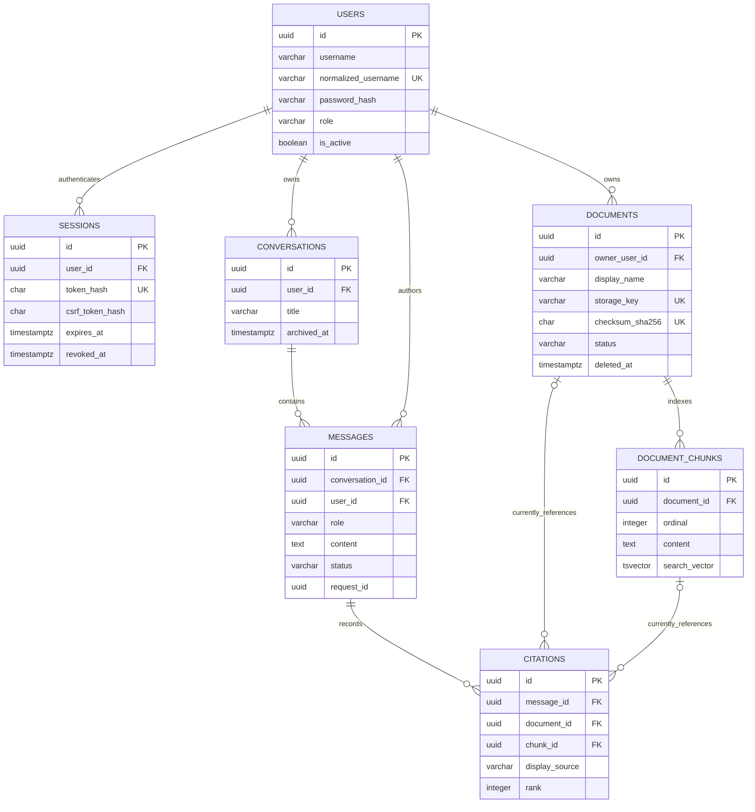

# Database relationships

The schema is PostgreSQL and TypeORM-migration managed. `synchronize` remains disabled. The ER diagram reflects the foreign keys in `1700000000000-InitialProductSchema`; the checksum and search-vector migrations add uniqueness and search indexing.

## Relationship rules

| Parent → child | Cardinality | Delete behavior / invariant |
| --- | --- | --- |
| users → sessions | 1 to many | `ON DELETE CASCADE`; token hash unique, user and expiry indexed. |
| users → documents | 1 to many | `ON DELETE RESTRICT`; owner is required. |
| documents → document_chunks | 1 to many | `ON DELETE CASCADE`; `(document_id, ordinal)` unique; GIN index covers `search_vector`. |
| users → conversations | 1 to many | `ON DELETE RESTRICT`; `(id,user_id)` unique supports ownership FK. |
| conversations → messages | 1 to many | Composite `(conversation_id,user_id)` FK references `(id,user_id)` and cascades on conversation delete. |
| users → messages | 1 to many | `ON DELETE RESTRICT`; duplicates conversation owner in FK to prevent cross-owner messages. |
| messages → citations | 1 to many | `ON DELETE CASCADE`; rank ordered per message by index. |
| documents/chunks → citations | 1 to many, nullable | `ON DELETE SET NULL`; citation source/page/section/rank/score snapshot remains. The schema has independent document and chunk FKs, not a composite check that the chunk belongs to that document. |

## Indexes and persistence notes

- Users: unique `normalized_username`.
- Sessions: unique `token_hash`; indexes on `user_id` and `expires_at`.
- Documents: unique `storage_key`; unique SHA-256 checksum (added by migration); status index.
- Chunks: unique `(document_id, ordinal)` and GIN `search_vector`; trigger refreshes the `simple` tsvector on insert or content update.
- Conversations: unique `(id,user_id)` and `(user_id, updated_at DESC)` index.
- Messages: `(conversation_id, created_at)` index and partial unique `(user_id, request_id)` for user messages with a request ID.
- Citations: `(message_id, rank)` index.

Original document bytes are stored via `DocumentStorage`; `storage_key` identifies them. PostgreSQL stores document metadata, chunk text, and evidence snapshots. See [initial migration](../../apps/api/src/database/migrations/1700000000000-InitialProductSchema.ts), [checksum migration](../../apps/api/src/database/migrations/1700000001000-UniqueDocumentChecksum.ts), and [search migration](../../apps/api/src/database/migrations/1700000002000-SearchVectorTrigger.ts).
