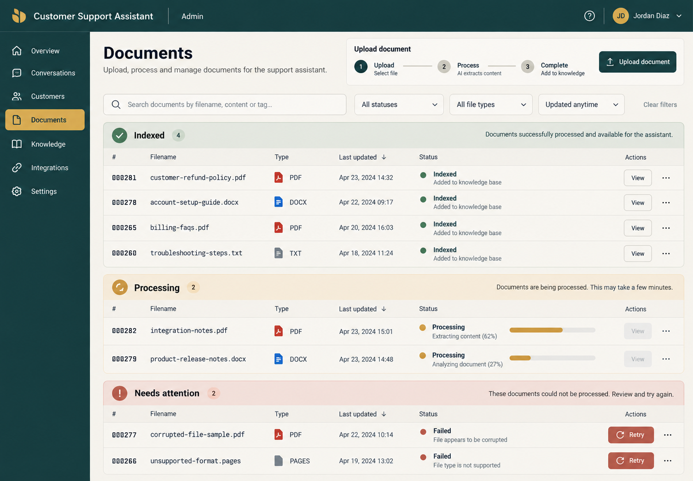

# Approved UI direction — Task 7

The Admin workspace uses the approved “Split-flap rhythm” reference. The browser review receipt approved the masthead and side rail and confirmed the indexed, processing, attention, and upload regions. Product records and counts come only from the API; fake sample records, fabricated progress, unsupported formats, and customer-facing routes are omitted.

- Palette: evergreen `#173B3F`, warm paper `#F3EFE3`, brass `#D8A64E`, clay `#B65C45`, sage `#5A7867`.
- Purpose: operational document and account management for one internal support team. Prioritize status scanning, clear recovery, keyboard operation, and mobile reflow.
- The uploaded reference image suggested additional navigation and sample rows. Those were not product capabilities and are excluded. The Angular chat route remains a placeholder until Task 8.
- No fake processing percentage or animated flap effect. Upload percentage is shown only from browser transfer events; document indexing is reported from persisted API status.
- Status must pair clear text with restrained color. Actions use explicit labels. Destructive removal requires confirmation.
- The approved PNG comp is copied to `.impeccable/mocks/task7-documents-option-1.png`; its browser response initially named a stale WebP path, recorded here to preserve provenance.

